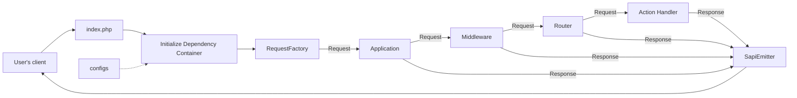

# Flujo de trabajo de la aplicación

Tras instalar Yii, tienes una aplicación Yii funcionando. Esta sección
presenta la funcionalidad integrada de la aplicación, cómo está organizado
el código y cómo gestiona la aplicación las solicitudes en general.

Ten en cuenta que, a diferencia del propio framework, una vez que instalas
una plantilla de proyecto, es toda tuya. Puedes añadir o eliminar código y,
en general, modificarla como necesites.

## Funcionalidad

La aplicación instalada contiene una sola página, accesible en
`http://localhost/`. Usa un layout común que puedes reutilizar en otras
páginas.

<!--
También deberías ver una barra de herramientas en la parte inferior de la ventana del navegador.
Es una útil [herramienta de depuración](https://github.com/yiisoft/yii-debug) que proporciona Yii para registrar y mostrar mucha
información de depuración, como mensajes de log, estados de las respuestas, las consultas ejecutadas en la base de datos, etc.
-->

Además de la aplicación web, puedes acceder a un script de consola mediante
`./yii` o, si usas Docker, `make yii`. Usa este script para ejecutar tareas
en segundo plano y de mantenimiento de la aplicación, que se describen en la
sección [Aplicaciones de consola](../tutorial/console-applications.md).

## Depurador experimental

Yii tiene un depurador que puede recopilar datos de depuración de las
solicitudes web y exponerlos a través de [Yii Dev
Panel](https://yiisoft.github.io/yii-dev-panel/). El depurador está en
desarrollo: no se publica como paquete estable, y su API, sus rutas y su
configuración pueden cambiar o quedar obsoletas.

Para probar la versión de desarrollo actual, instala el paquete de la API de
depuración:

```shell
composer require yiisoft/yii-debug-api:^3.0@dev
```

Activa el modo de depuración en `.env`:

```dotenv
APP_DEBUG=true
```

El paquete registra sus rutas automáticamente. Inicia la aplicación y abre
`/debug` para comprobar que la API de depuración está disponible. Después,
abre [Yii Dev Panel](https://yiisoft.github.io/yii-dev-panel/) y configura
allí la URL de tu aplicación.

> [!CAUTION]
> Usa el modo de depuración solo para el desarrollo local. En producción, mantén `APP_DEBUG=false` y no expongas públicamente las rutas de depuración.

## Estructura de la aplicación

Los directorios y archivos más importantes de tu aplicación son estos
(suponiendo que el directorio raíz de la aplicación es `app`):

```
assets/                 Asset bundle source files.
config/                 Configuration files.
    common/             Common configuration and DI definitions.
    console/            Console-specific configuration.
    environments/       Environment-specific configuration (dev/test/prod).
    web/                Web-specific configuration.
docker/                 Docker-specific files.
public/                 Files publically accessible from the Internet.
    assets/             Published/compiled assets.
    index.php           Entry script.
runtime/                Files generated during runtime.
src/                    Application source code.
    Console/            Console commands.
    Shared/             Code shared between web and console applications.
    Web/                Web-specific code (actions, handlers, layout).
        Shared/         Shared web components.
            Layout/     Layout components and templates.
    Environment.php     Environment configuration class.
tests/                  A set of Codeception tests for the application.
    Console/            Console command tests.
    Functional/         Functional tests.
    Unit/               Unit tests.
    Web/                Web actions tests.
vendor/                 Installed Composer packages.
Makefile                Config for make command.
yii                     Console application entry point.
```

En general, los archivos de la aplicación se dividen en dos grupos: los que
están en `app/public` y los que están en otros directorios. A los primeros
puedes acceder directamente por HTTP (es decir, desde un navegador),
mientras que los segundos no deberías exponerlos.

Cada aplicación tiene un script de entrada, `public/index.php`, que es el
único script PHP de la aplicación accesible desde la web. El script de
entrada usa un [ejecutor (runner) de la
aplicación](https://github.com/yiisoft/yii-runner) para crear una instancia
de la solicitud entrante con la ayuda de uno de los paquetes PSR-7 y la pasa
a una instancia de la [aplicación](../structure/application.md). La
aplicación ejecuta secuencialmente un conjunto de middlewares para procesar
la solicitud. Después pasa el resultado al emisor, que envía la respuesta al
navegador.

Según los middlewares que uses, la aplicación puede comportarse de forma
diferente. Por defecto, un router usa la URL solicitada y la configuración
para elegir un manejador y ejecutarlo para producir una respuesta.

Puedes obtener más información sobre la plantilla de aplicación en la
[documentación del paquete
yiisoft/app](https://github.com/yiisoft/app/blob/master/README.md).

## Ciclo de vida de la solicitud

El siguiente diagrama muestra cómo gestiona una aplicación una solicitud.



1. Un usuario hace una solicitud al [script de
   entrada](../structure/entry-script.md) `public/index.php`.
2. El script de entrada, con la ayuda del ejecutor de la aplicación, carga
   la [configuración](../concept/configuration.md) del contenedor y crea una
   instancia de la [aplicación](../structure/application.md) y los servicios
   necesarios para gestionar la solicitud.
3. La factoría de solicitudes crea un objeto de solicitud a partir de la
   solicitud en bruto que ha llegado del usuario.
4. La aplicación pasa el objeto de solicitud por el array de middlewares
   configurado. Uno de ellos suele ser un router.
5. El router determina qué manejador ejecutar en función de la solicitud y
   la configuración.
6. El manejador puede cargar algunos datos, posiblemente de una base de
   datos.
7. El manejador construye una respuesta con esos datos, ya sea directamente
   o con la ayuda del paquete de vistas.
8. El emisor recibe la respuesta y se encarga de enviarla al navegador del
   usuario.
