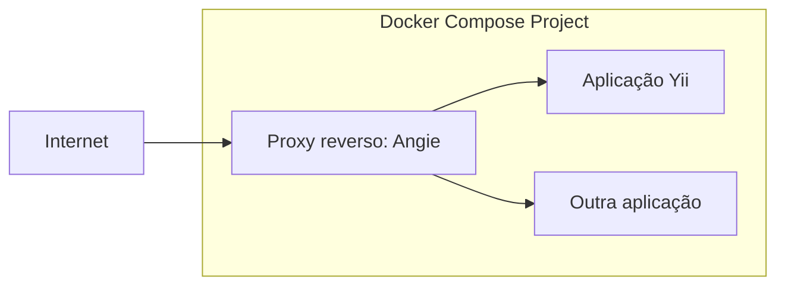

# Fazendo deploy de aplicações Yii com o Angie Docker Proxy

O [Angie Docker Proxy](https://hub.docker.com/r/angiesoftware/proxy) é um
pequeno proxy reverso para projetos Docker Compose. Ele roda em um container
separado, ao lado das aplicações, lê a API do Docker pelo socket do Docker,
descobre containers pelas variáveis de ambiente `VIRTUAL_HOST` e
`VIRTUAL_PORT`, gera a configuração do Angie e obtém certificados TLS
automaticamente via ACME.

Essa abordagem é útil quando você precisa rodar várias aplicações web em um
servidor e habilitar HTTPS para elas sem editar manualmente a configuração
do proxy reverso para cada domínio.

Neste exemplo, vamos conectar uma aplicação Yii em container ao Angie Docker
Proxy e configurar HTTPS automático.

Este guia assume que sua aplicação Yii já está empacotada como imagem Docker
e aceita requisições HTTP na porta 80. Construir e configurar a imagem da
aplicação está fora do escopo deste guia.



## Pré-requisitos

- Um servidor com uma distribuição Linux recém-instalada.
- Um nome de domínio apontando para o IP do seu servidor.
- Docker e Docker Compose.
- Portas TCP `80` e `443` abertas.
- Acesso SSH ao seu servidor.
- Conhecimento básico de Docker e de ferramentas de linha de comando.

## Estrutura do projeto

O exemplo precisa de uma única configuração do Docker Compose:

```text
yii-angie-demo/
└── docker-compose.yml
```

## Configurando o Docker Compose

Crie o `docker-compose.yml` com a configuração a seguir. Substitua:

- `admin@example.com` pelo seu endereço de e-mail;
- `registry.example.com/yii-app:1.0.0` pela imagem da sua aplicação;
- `example-demo.example.com` pelo domínio que aponta para o seu servidor.

```yaml
services:
  angie-proxy:
    image: angiesoftware/proxy:latest
    environment:
      - ANGIE_ACME_EMAIL=admin@example.com
      - ANGIE_ACME_URL=https://acme-v02.api.letsencrypt.org/directory
      - ANGIE_RESOLVER=1.1.1.1 8.8.8.8
      - ANGIE_RESOLVER_VALID=300s
      - ANGIE_PROXY_NETWORK=proxy
    ports:
      - "80:80"
      - "443:443"
    volumes:
      - /var/run/docker.sock:/tmp/docker.sock:ro
      - angie_acme:/var/lib/angie/acme
    networks:
      - proxy

  yii-app:
    image: registry.example.com/yii-app:1.0.0
    environment:
      - VIRTUAL_HOST=example-demo.example.com
      - VIRTUAL_PORT=80
    networks:
      - proxy

networks:
  proxy:
    name: proxy

volumes:
  angie_acme:
```

`VIRTUAL_HOST` é o domínio público da aplicação.

`VIRTUAL_PORT` é a porta interna do container para a qual o Angie deve
encaminhar as requisições.

O Angie Docker Proxy descobre `VIRTUAL_HOST` e `VIRTUAL_PORT`
automaticamente pelas variáveis de ambiente e emite certificados usando o
módulo ACME do Angie e o Let's Encrypt.

## Subindo os serviços

Suba os containers do proxy e da aplicação:

```bash
docker compose up -d
```

## Adicionando outra aplicação

Para expor outra aplicação, adicione-a em `services` no `docker-compose.yml`
e conecte-a à rede `proxy`:

```yaml
services:
  second-app:
    image: traefik/whoami
    environment:
      - VIRTUAL_HOST=example-demo2.example.com
      - VIRTUAL_PORT=80
    networks:
      - proxy
```

Aplique as alterações:

```bash
docker compose up -d
```

## Como funciona

O Angie Docker Proxy monitora a API do Docker e descobre os containers
configurados com `VIRTUAL_HOST` e `VIRTUAL_PORT`.  Ele gera a configuração
do Angie, obtém certificados TLS via ACME e encaminha as requisições
recebidas para os containers correspondentes pela rede Docker compartilhada.

Quando containers são adicionados, removidos ou atualizados, o proxy gera a
configuração de novo e faz um reload gracioso.  As conexões existentes
continuam sendo atendidas enquanto a configuração atualizada é aplicada.

Para opções de configuração e detalhes de implementação, veja a
[documentação do Angie Docker
Proxy](https://hub.docker.com/r/angiesoftware/proxy).

## Verificação

Verifique os containers:

```bash
docker compose ps
```

Verifique o redirecionamento HTTP:

```bash
curl -I http://example-demo.example.com/
```

Resultado esperado:

```text
HTTP/1.1 301 Moved Permanently
Location: https://example-demo.example.com/
```

Verifique o HTTPS:

```bash
curl -I https://example-demo.example.com/
```

Resultado esperado:

```text
HTTP/1.1 200 OK
Server: Angie/...
```

Verifique o certificado:

```bash
echo | openssl s_client \
  -connect example-demo.example.com:443 \
  -servername example-demo.example.com 2>/dev/null \
  | openssl x509 -noout -issuer -subject -dates
```

Emissor esperado:

```text
Let's Encrypt
```


## Logs

Logs do proxy:

```bash
docker compose logs -f angie-proxy
```

## Parando os serviços

Pare os serviços:

```bash
docker compose down
```

Pare os serviços e remova os certificados:

```bash
docker compose down -v
```

## Limitações

Esta configuração é feita para o Docker Compose. O Kubernetes não expõe
workloads pela API do Docker e exige um controller de Ingress ou de Gateway
API. O Docker Swarm também usa a API do Docker, mas o deploy no Swarm não é
coberto neste guia.

## Para mais informações

- [Documentação do Angie Docker
  Proxy](https://hub.docker.com/r/angiesoftware/proxy)
- [Template de aplicação do Yii](https://github.com/yiisoft/app)
- [Docker nos templates de aplicação do
  Yii](https://yiisoft.github.io/docs/guide/tutorial/docker.html)
- [Documentação do Docker Compose](https://docs.docker.com/compose/)
