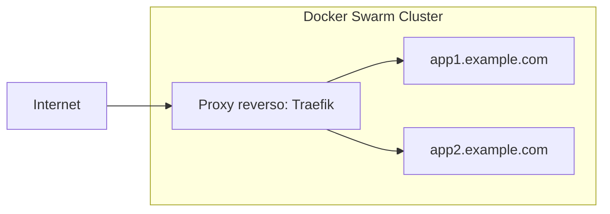

# Fazendo deploy de aplicações Yii no Docker Swarm com Traefik

Este guia mostra como fazer o deploy de uma aplicação Yii no [Docker
Swarm](https://docs.docker.com/engine/swarm/)  a partir de um servidor
vazio, usando o [Traefik](https://traefik.io/traefik) como proxy reverso e
fazendo o deploy a partir de um registro de containers
([Forgejo](https://forgejo.org/) ou [Gitea](https://about.gitea.com/)).



## Pré-requisitos

- Um servidor com uma distribuição Linux recém-instalada (recomendado Ubuntu
  22.04 LTS ou mais recente)
- Um nome de domínio apontando para o IP do seu servidor
- Acesso SSH ao seu servidor
- Conhecimento básico de Docker e de ferramentas de linha de comando

## Preparando o servidor

### Instale o Docker

Para as instruções de instalação, veja a [documentação oficial do
Docker](https://docs.docker.com/engine/install/ubuntu/).

### Inicialize o Docker Swarm

Inicialize o seu servidor como manager do Docker Swarm:

```bash
docker swarm init --advertise-addr <YOUR_SERVER_IP>
```

Substitua `<YOUR_SERVER_IP>` pelo IP público do seu servidor.

### Configure a rede do proxy reverso

Crie uma rede overlay dedicada para o proxy reverso se comunicar com os seus
serviços:

```bash
docker network create --driver=overlay reverse_proxy_public
```

## Configurando o Traefik como proxy reverso

Para fazer o deploy do Traefik como proxy reverso, crie um arquivo
`traefik-stack.yml`:

```yaml
services:
  traefik:
    image: traefik:v2.10
    command:
      - "--api.insecure=true"
      - "--providers.docker=true"
      - "--providers.docker.swarmMode=true"
      - "--providers.docker.exposedbydefault=false"
      - "--entrypoints.web.address=:80"
      - "--entrypoints.websecure.address=:443"
      - "--certificatesresolvers.letsencrypt.acme.tlschallenge=true"
      - "--certificatesresolvers.letsencrypt.acme.email=admin@example.com"
      - "--certificatesresolvers.letsencrypt.acme.storage=/letsencrypt/acme.json"
    ports:
      - "80:80"
      - "443:443"
      - "8080:8080"
    volumes:
      - "/var/run/docker.sock:/var/run/docker.sock:ro"
      - "traefik_certificates:/letsencrypt"
    networks:
      - reverse_proxy_public
    deploy:
      placement:
        constraints:
          - node.role == manager

volumes:
  traefik_certificates:

networks:
  reverse_proxy_public:
    external: true
```

Faça o deploy do Traefik:

```bash
docker stack deploy -c traefik-stack.yml traefik
```

## Configurando um registro de containers

Você precisa de um registro de containers para guardar as suas imagens
Docker. Escolha uma das opções a seguir.

### Opção 1: usando o Forgejo

Para fazer o deploy do Forgejo, crie um arquivo `forgejo-stack.yml`:

```yaml
services:
  forgejo:
    image: codeberg.org/forgejo/forgejo:1.21
    ports:
      - "3000:3000"
    volumes:
      - forgejo_data:/data
    networks:
      - reverse_proxy_public
    deploy:
      labels:
        - "traefik.enable=true"
        - "traefik.http.routers.app.rule=Host(`git.example.com`)"
        - "traefik.http.routers.app.entrypoints=websecure"
        - "traefik.http.routers.app.tls.certresolver=letsencrypt"
        - "traefik.http.services.app.loadbalancer.server.port=3000"        

volumes:
  forgejo_data:

networks:
  reverse_proxy_public:
    external: true
```

Faça o deploy do Forgejo:

```bash
docker stack deploy -c forgejo-stack.yml forgejo
```

Substitua `git.example.com` pelo subdomínio desejado.

Depois do deploy, acesse o Forgejo em `https://git.example.com` e conclua a
configuração inicial.  Não esqueça de habilitar o registro de containers nas
configurações.

### Opção 2: usando o Gitea

Para fazer o deploy do Gitea, crie um arquivo `gitea-stack.yml`:

```yaml
services:
  gitea:
    image: gitea/gitea:latest
    ports:
      - "3000:3000"
    volumes:
      - gitea_data:/data
    networks:
      - reverse_proxy_public
    deploy:
      labels:
        - "traefik.enable=true"
        - "traefik.http.routers.app.rule=Host(`git.example.com`)"
        - "traefik.http.routers.app.entrypoints=websecure"
        - "traefik.http.routers.app.tls.certresolver=letsencrypt"
        - "traefik.http.services.app.loadbalancer.server.port=3000"        

volumes:
  gitea_data:

networks:
  reverse_proxy_public:
    external: true
```

Faça o deploy do Gitea:

```bash
docker stack deploy -c gitea-stack.yml gitea
```

Substitua `git.example.com` pelo subdomínio desejado.

Depois do deploy, acesse o Gitea em `https://git.example.com` e conclua a
configuração inicial.  Não esqueça de habilitar o registro de containers nas
configurações.

## Configurando a sua aplicação Yii

### Atualize a configuração do Makefile

O [template de aplicação do Yii](https://github.com/yiisoft/app) inclui um
Makefile com comandos de deploy. Atualize o arquivo `docker/.env` do seu
projeto:

```bash
STACK_NAME=myapp

#
# Produção
#

PROD_HOST=app.example.com
PROD_SSH="ssh://user@your-server-ip"

IMAGE=git.example.com/username/myapp
IMAGE_TAG=latest
```

Substitua os valores: - `STACK_NAME`: um nome único para a stack da sua
aplicação - `PROD_HOST`: o nome de domínio em que a aplicação vai ficar
acessível - `PROD_SSH`: a string de conexão SSH com o seu servidor (formato:
`ssh://user@host`)  - `IMAGE`: o caminho completo da imagem do container no
registro - `IMAGE_TAG`: a tag da imagem, normalmente `latest` ou um número
de versão

### Configure o ambiente de produção

Atualize o `docker/prod/.env` com as variáveis de ambiente de produção:

```bash
APP_ENV=prod
YII_DEBUG=false
YII_ENV=prod

# Configuração do banco de dados
DB_HOST=db
DB_NAME=myapp
DB_USER=myapp
DB_PASSWORD=secure_password_here

# Adicione outras variáveis específicas do ambiente
```

> [!WARNING]
> Nunca faça commit de credenciais sensíveis no controle de versão. Use `docker/prod/override.env` para valores sensíveis e adicione-o ao `.gitignore`.

### Revise a configuração do Docker Compose de produção

Ao usar o Traefik, você precisa alterar o `docker/prod/compose.yml` da
aplicação Yii para usar labels do Traefik em vez de labels do Caddy:

```yaml
services:
  app:
    image: ${IMAGE}:${IMAGE_TAG}
    networks:
      - reverse_proxy_public
    volumes:
      - runtime:/app/runtime
      - caddy_data:/data
      - caddy_config:/config
    env_file:
      - path: ./prod/.env
      - path: ./prod/override.env
        required: false\
    environment:
      CADDY_EXTRA_CONFIG: 'auto_https off'
    deploy:
      replicas: 2
      update_config:
        delay: 10s
        parallelism: 1
        order: start-first
        failure_action: rollback
        monitor: 10s
      rollback_config:
        parallelism: 0
        order: stop-first
      restart_policy:
        condition: on-failure
        delay: 5s
        max_attempts: 3
        window: 120s
      labels:
        - "traefik.enable=true"
        - "traefik.http.routers.app.rule=Host(`${PROD_HOST:-app.example.com}`)"
        - "traefik.http.routers.app.entrypoints=websecure"
        - "traefik.http.routers.app.tls.certresolver=letsencrypt"
        - "traefik.http.services.app.loadbalancer.server.port=80"
```

Essa configuração:
- Roda 2 réplicas para alta disponibilidade
- Usa uma estratégia de rolling update com rollback automático em caso de falha
- Configura `labels` para HTTPS automático no proxy reverso
- Desabilita a obtenção de certificados HTTPS no próprio container,
  já que o proxy se comunica com o container via HTTP. Isso é o `auto_https off`.

Se você precisa de um banco de dados, adicione-o à stack:

```yaml
services:
  app:
    # ... configuração existente ...
    
  db:
    image: postgres:18-alpine
    environment:
      POSTGRES_DB: myapp
      POSTGRES_USER: myapp
      POSTGRES_PASSWORD_FILE: /run/secrets/db_password
      POSTGRES_INITDB_ARGS: "--locale-provider=icu --icu-locale=und --encoding=UTF8"
    volumes:
      - db_data:/var/lib/postgresql
    networks:
      - reverse_proxy_public
    deploy:
      placement:
        constraints:
          - node.role == manager
    secrets:
      - db_password

volumes:
  runtime:
  db_data:

secrets:
  db_password:
    external: true
```

Crie o secret com a senha do banco de dados no servidor:

```bash
echo "your_secure_password" | docker secret create db_password -
```

## Construindo e enviando a imagem

### Configure o login do Docker na sua máquina local

Configure o Docker para se autenticar no seu registro de containers:

```bash
docker login git.example.com
```

Informe o seu usuário e a sua senha quando solicitado.

### Construa a imagem de produção

Use o Makefile para construir a imagem de produção:

```bash
make prod-build
```

Isso executa o comando definido no Makefile:

```bash
docker build --file docker/Dockerfile --target prod --pull -t ${IMAGE}:${IMAGE_TAG} .
```

O Dockerfile usa um build multi-stage: 1. Instala as dependências do
Composer em um estágio de build 2. Cria uma imagem de produção mínima, só
com os arquivos necessários 3. Roda como um usuário não root (`www-data`)

### Envie a imagem para o registro

Envie a imagem construída para o registro de containers:

```bash
make prod-push
```

Isso executa:

```bash
docker push ${IMAGE}:${IMAGE_TAG}
```

## Fazendo deploy no Docker Swarm

### Configure o acesso SSH

Configure a autenticação por chave SSH no seu servidor:

```bash
# Gera uma chave SSH (se você ainda não tiver uma)
ssh-keygen -t ed25519 -C "your_email@example.com"

# Copia a chave para o seu servidor
ssh-copy-id user@your-server-ip

# Adiciona o host SSH à sua configuração SSH (~/.ssh/config)
cat >> ~/.ssh/config << EOF
Host docker-web
    HostName your-server-ip
    User user
    IdentityFile ~/.ssh/id_ed25519
EOF
```

### Configure o contexto do Docker

Crie um contexto do Docker para o deploy remoto:

```bash
docker context create swarm-prod --docker "host=ssh://docker-web"
```

Como alternativa, configure a variável de ambiente `DOCKER_HOST`:

```bash
export DOCKER_HOST=ssh://docker-web
```

### Faça o deploy da aplicação

Faça o deploy da stack da sua aplicação no Docker Swarm:

```bash
make prod-deploy
```

Isso executa:

```bash
docker -H ${PROD_SSH} stack deploy --prune --detach=false --with-registry-auth -c docker/compose.yml -c docker/prod/compose.yml ${STACK_NAME}
```

A flag `--with-registry-auth` garante que os nós do Swarm consigam baixar
imagens do seu registro privado.

### Verifique o deploy

Verifique o status dos seus serviços:

```bash
docker -H ssh://docker-web service ls
docker -H ssh://docker-web service ps ${STACK_NAME}_app
```

Veja os logs:

```bash
docker -H ssh://docker-web service logs ${STACK_NAME}_app
```

## Monitoramento e manutenção

### Veja os logs do serviço

```bash
# Mostra todos os logs
docker -H ssh://docker-web service logs -f ${STACK_NAME}_app

# Mostra as últimas 100 linhas de log
docker -H ssh://docker-web service logs --tail 100 ${STACK_NAME}_app

# Mostra os logs com timestamps
docker -H ssh://docker-web service logs -t ${STACK_NAME}_app
```

### Escale a aplicação

Ajuste o número de réplicas:

```bash
docker -H ssh://docker-web service scale ${STACK_NAME}_app=3
```

Ou atualize o valor de `replicas` em `docker/prod/compose.yml` e faça o
deploy de novo.

### Limites de recursos

Adicione limites de recursos para evitar que os containers consumam todos os
recursos do servidor. Atualize o `docker/prod/compose.yml`:

```yaml
services:
  app:
    # ... configuração existente ...
    deploy:
      resources:
        limits:
          cpus: '0.5'
          memory: 512M
        reservations:
          cpus: '0.25'
          memory: 256M
```

## Considerações de segurança

### Use Docker secrets para dados sensíveis

Em vez de variáveis de ambiente, use Docker secrets para informações
sensíveis:

```bash
# Cria os secrets
echo "database_password" | docker secret create db_password -
echo "api_key" | docker secret create api_key -
```

Atualize o `docker/prod/compose.yml`:

```yaml
services:
  app:
    secrets:
      - db_password
      - api_key

secrets:
  db_password:
    external: true
  api_key:
    external: true
```

Acesse os secrets na sua aplicação em `/run/secrets/secret_name`.

### Configure um firewall

Configure o UFW (Uncomplicated Firewall) no seu servidor:

```bash
# Libera SSH
sudo ufw allow 22/tcp

# Libera HTTP e HTTPS
sudo ufw allow 80/tcp
sudo ufw allow 443/tcp

# Libera as portas do Docker Swarm (se você pretende adicionar mais nós)
sudo ufw allow 2377/tcp
sudo ufw allow 7946/tcp
sudo ufw allow 7946/udp
sudo ufw allow 4789/udp

# Habilita o firewall
sudo ufw enable
```

### Mantenha o sistema atualizado

Atualize regularmente o seu servidor e o Docker:

```bash
# Atualiza os pacotes do sistema
sudo apt-get update && sudo apt-get upgrade -y

# Atualiza as imagens Docker
docker -H ssh://docker-web service update --image ${IMAGE}:${IMAGE_TAG} ${STACK_NAME}_app
```

## Solução de problemas

### O serviço não sobe

Verifique os eventos e os logs do serviço:

```bash
docker -H ssh://docker-web service ps ${STACK_NAME}_app --no-trunc
docker -H ssh://docker-web service logs ${STACK_NAME}_app
```

Problemas comuns: - **Erros ao baixar a imagem**: verifique a autenticação
no registro com `docker -H ssh://docker-web login` - **Conflitos de porta**:
garanta que nenhum outro serviço esteja usando as portas 80/443 -
**Limitação de recursos**: verifique os recursos disponíveis com `docker -H
ssh://docker-web node ls`

### Problemas com certificados SSL

Se o Traefik não consegue obter os certificados: - Verifique se o DNS aponta
para o seu servidor - Verifique se as portas 80 e 443 estão acessíveis pela
internet - Garanta que o e-mail na configuração do Let's Encrypt é válido -
Verifique os logs: `docker -H ssh://docker-web service logs traefik_traefik`

### Problemas de conexão com o registro de containers

Teste a conectividade com o registro:

```bash
# Na sua máquina local
docker pull git.example.com/username/myapp:latest

# No servidor
docker -H ssh://docker-web pull git.example.com/username/myapp:latest
```

## Resumo

Você fez o deploy de uma aplicação Yii no Docker Swarm com: - Um registro de
containers (Forgejo ou Gitea)  - HTTPS automático via Traefik - Deploys sem
downtime com rolling updates - Alta disponibilidade com várias réplicas

Os comandos do Makefile simplificam o fluxo de deploy: - `make prod-build` -
Constrói a imagem de produção - `make prod-push` - Envia para o registro -
`make prod-deploy` - Faz o deploy no Docker Swarm

Para mais informações, veja: - [Template de aplicação do
Yii](https://github.com/yiisoft/app)  - [Documentação do Docker
Swarm](https://docs.docker.com/engine/swarm/)  - [Documentação do
Traefik](https://doc.traefik.io/traefik/)
