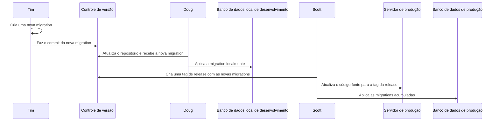

# Migrations

Ao longo do desenvolvimento e da manutenção de uma aplicação que usa banco
de dados, a estrutura do banco evolui assim como o código-fonte. Por
exemplo, durante o desenvolvimento de uma aplicação, pode surgir a
necessidade de uma nova tabela; depois que a aplicação vai para produção,
pode-se descobrir que é preciso criar um índice para melhorar o desempenho
de uma consulta; e assim por diante. Como uma mudança na estrutura do banco
de dados muitas vezes exige mudanças no código-fonte, o Yii oferece o
recurso chamado *migration de banco de dados*, que permite acompanhar as
mudanças no banco em forma de *migrations*, versionadas junto com o
código-fonte.

Os passos a seguir mostram como uma equipe pode usar migrations durante o
desenvolvimento:

1. Tim cria uma nova migration (por exemplo, cria uma nova tabela, altera a
   definição de uma coluna etc.).
2. Tim faz o commit da nova migration no sistema de controle de versão (por
   exemplo, Git, Mercurial).
3. Doug atualiza o repositório dele a partir do sistema de controle de
   versão e recebe a nova migration.
4. Doug aplica a migration ao banco de dados local de desenvolvimento,
   sincronizando o banco dele com as mudanças que Tim fez.

E os passos a seguir mostram como fazer o deploy de uma nova release com
migrations para produção:

1. Scott cria uma tag de release no repositório do projeto que contém
   algumas migrations novas.
2. Scott atualiza o código-fonte no servidor de produção para a tag da
   release.
3. Scott aplica todas as migrations acumuladas ao banco de dados de
   produção.



O Yii fornece um conjunto de ferramentas de linha de comando para migrations
que permitem:

* criar novas migrations;
* aplicar migrations;
* reverter migrations;
* reaplicar migrations;
* mostrar o histórico e o status das migrations.

Todas essas ferramentas são acessíveis pelo comando `yii migrate`. Nesta
seção, vamos descrever em detalhes como realizar várias tarefas usando essas
ferramentas.

> [!TIP]
> Migrations podem afetar não só o schema do banco de dados, mas também ajustar dados existentes ao novo schema, criar a hierarquia
de RBAC ou limpar o cache.

> [!NOTE]
> Ao manipular dados em uma migration, pode parecer útil usar suas classes Active Record ou de entidade,
> já que parte da lógica já está implementada nelas. Lembre-se, porém, de que, ao contrário
> do código escrito nas migrations, que por natureza deve permanecer constante para sempre, a lógica da aplicação está sujeita a mudanças.
> Então, ao usar classes Active Record ou de entidade no código de migrations, mudanças na lógica do código-fonte
> podem quebrar acidentalmente as migrations existentes. Por isso, o código das migrations deve ser mantido independente do restante
> da lógica da aplicação.

## Configuração inicial

Para usar migrations, instale o pacote
[yiisoft/db-migration](https://github.com/yiisoft/db-migration/):

```shell
make composer require yiisoft/db-migration
```

Crie um diretório `src/Migration` para armazenar as migrations, diretamente
na raiz do projeto.

Adicione a seguinte configuração em `config/common/params.php`:

```php
'yiisoft/db-migration' => [
    'newMigrationNamespace' => 'App\\Migration',
    'sourceNamespaces' => ['App\\Migration'],
],
```

Se você quiser colocar as migrations em outro lugar, pode definir o caminho
em `newMigrationPath`. Se as migrations a aplicar vêm de várias fontes, como
módulos externos, você pode usar `sourcePaths` para defini-las.

Você também precisa de uma conexão com o banco de dados configurada. Veja
[Trabalhando com banco de dados](../start/databases.md) para um exemplo de
configuração com PostgreSQL.

## Criando uma migration

Para criar uma nova migration vazia, execute o seguinte comando:

```sh
make shell
./yii migrate:create <name>
```

O argumento obrigatório `name` dá uma breve descrição da nova migration. Por
exemplo, se a migration cria uma nova tabela chamada *news*, você pode usar
o nome `create_news_table` e executar o seguinte comando:

```
make shell
./yii migrate:create create_news_table
```


> [!NOTE]
> Como o argumento `name` é usado como parte do nome da classe de migration gerada,
> ele deve conter apenas letras, dígitos e/ou underscores.

O comando acima cria um novo arquivo de classe PHP chamado
`src/Migration/M251225221906CreateNewsTable.php`.  O arquivo contém o código
a seguir, que basicamente declara uma classe de migration com o esqueleto do
código:

```php
<?php

declare(strict_types=1);

namespace App\Migration;

use Yiisoft\Db\Migration\MigrationBuilder;
use Yiisoft\Db\Migration\RevertibleMigrationInterface;

final class M251225221906CreateNewsTable implements RevertibleMigrationInterface
{
    public function up(MigrationBuilder $b): void
    {
        // TODO: Implemente a lógica para aplicar a migration.
    }

    public function down(MigrationBuilder $b): void
    {
        // TODO: Implemente a lógica para reverter a migration.
    }
}
```

Na classe de migration, espera-se que você escreva no método `up()` o código
que altera a estrutura do banco de dados.  Você também pode escrever no
método `down()` o código que reverte as mudanças feitas por `up()`. O método
`up()` é chamado quando você atualiza o banco de dados com esta migration, e
o método `down()` é chamado quando você faz o downgrade do banco.  O código
a seguir mostra como implementar a classe de migration para criar uma tabela
`news`:

```php
<?php

declare(strict_types=1);

namespace App\Migration;

use Yiisoft\Db\Migration\MigrationBuilder;
use Yiisoft\Db\Migration\RevertibleMigrationInterface;

final class M251225221906CreateNewsTable implements RevertibleMigrationInterface
{
    public function up(MigrationBuilder $b): void
    {
        $cb = $b->columnBuilder();

        $b->createTable('news', [
            'id' => $cb::uuidPrimaryKey(),
            'title' => $cb::string()->notNull(),
            'content' => $cb::text(),
        ]);
    }

    public function down(MigrationBuilder $b): void
    {
        $b->dropTable('news');
    }
}
```

No exemplo acima, o migration builder `$b` gerencia o schema do banco de
dados, enquanto o column builder `$cb` gerencia os tipos de coluna. Ambos
permitem usar *tipos abstratos*. Quando uma migration é aplicada a um banco
de dados específico, os tipos abstratos são traduzidos para os tipos físicos
correspondentes do banco e para o SQL correspondente que os define.

Os métodos disponíveis no migration builder se dividem nos seguintes tipos:

- Consultas SQL puras
  - getDb — para obter a instância da conexão com o banco de dados.
  - execute — para executar uma consulta SQL pura.
- Dados
  - insert / update / delete
  - batchInsert
  - upsert
- Tabelas e views
  - createTable / renameTable / dropTable
  - truncateTable
  - addCommentOnTable / dropCommentFromTable
  - createView / dropView
- Colunas
  - addColumn / renameColumn / alterColumn / dropColumn
  - addCommentOnColumn / dropCommentFromColumn
- Chaves e índices
  - addPrimaryKey / dropPrimaryKey
  - addForeignKey / dropForeignKey
  - createIndex / dropIndex

Além disso, há um `columnBuilder()`, usado para obter um column builder como
no exemplo acima. O builder tem métodos estáticos que definem vários tipos
de coluna:

- Chaves
    - primaryKey
    - smallPrimaryKey
    - bigPrimaryKey
    - uuidPrimaryKey
- Booleano
  - boolean
- Números
  - bit
  - tinyint
  - smallint
  - integer
  - bigint
  - flat
  - double
  - decimal
- Strings
  - char
  - string
  - text
- Data e hora
  - timestamp
  - datetime
  - datetimeWithTimezone
  - time
  - timeWithTimezone
  - date
- Tipos especiais
  - money
  - binary
  - uuid
  - array
  - structured
  - json
- enum

Todos os métodos acima criam um tipo base que pode ser ajustado com métodos
adicionais:

- null / notNull
- defaultValue
- unique
- scale / size / unsigned
- primaryKey / autoIncrement
- check
- comment
- computed
- extra
- reference

### Migrations irreversíveis

Nem todas as migrations são reversíveis. Por exemplo, se o método `up()`
apaga uma linha de uma tabela, talvez você não consiga recuperar essa linha
no método `down()`. Às vezes, você pode simplesmente não querer implementar
o `down()`, porque não é muito comum reverter migrations. Nesse caso,
implemente `Yiisoft\Db\Migration\MigrationInterface`, que tem apenas `up()`.


### Migrations transacionais

Ao executar migrations complexas, é importante garantir que cada migration
tenha sucesso ou falhe por completo, para que o banco de dados mantenha a
integridade e a consistência. Para isso, é recomendado envolver
automaticamente as operações de banco de cada migration em uma transação,
adicionando `TransactionalMigrationInterface` ao `implements` da sua
migration.

Assim, se qualquer operação no método `up()` ou `down()` falhar, todas as
operações anteriores serão desfeitas (rollback) automaticamente.

> Nota: nem todo SGBD dá suporte a transações. E algumas consultas não podem ser colocadas em uma transação. Para alguns exemplos,
consulte [implicit commit](https://dev.mysql.com/doc/refman/5.7/en/implicit-commit.html).

## Gerando uma migration

Em vez de escrever migrations à mão, o comando oferece uma forma prática de
gerar parte do código.

```shell
make shell
./yii migrate:create -- my_first_table --command=table --fields=name,example --table-comment=my_first_table
```

Isso geraria o seguinte:

```php
<?php

declare(strict_types=1);

namespace App\Migration;

use Yiisoft\Db\Migration\MigrationBuilder;
use Yiisoft\Db\Migration\RevertibleMigrationInterface;
use Yiisoft\Db\Migration\TransactionalMigrationInterface;

/**
 * Handles the creation of table `my_first_table`.
 */
final class M251227095006CreateMyFirstTableTable implements RevertibleMigrationInterface, TransactionalMigrationInterface
{
    public function up(MigrationBuilder $b): void
    {
        $columnBuilder = $b->columnBuilder();

        $b->createTable('my_first_table', [
            'id' => $columnBuilder::primaryKey(),
            'name',
            'example',
        ]);

        $b->addCommentOnTable('my_first_table', 'my_first_table');
    }

    public function down(MigrationBuilder $b): void
    {
        $b->dropTable('my_first_table');
    }
}
```

Os comandos disponíveis são:

- create - migration vazia.
- table - cria uma tabela. Use `--fields` para especificar a lista de
  campos. Também é possível especificar os tipos, como em
  `id:primaryKey,name:string:defaultValue("Alex"),user_id:integer:foreignKey,category_id2:integer:foreignKey(category
  id2)`.
- dropTable - remove uma tabela.
- addColumn - adiciona uma coluna.
- dropColumn - remove uma coluna.
- junction - cria uma tabela de junção. Use `--and` para especificar a
  segunda tabela.

## Aplicando migrations

Para atualizar um banco de dados para a estrutura mais recente, aplique
todas as migrations novas disponíveis com o seguinte comando:

```
./yii migrate:up
```

Esse comando lista todas as migrations que ainda não foram aplicadas. Se
você confirmar que quer aplicá-las, ele executa o método `up()` de cada nova
classe de migration, uma após a outra, na ordem de seus timestamps. Se
alguma das migrations falhar, o comando é encerrado sem aplicar as demais.

Para cada migration aplicada com sucesso, o comando insere uma linha em uma
tabela do banco chamada `migration` para registrar a aplicação
bem-sucedida. Isso permite que a ferramenta de migrations identifique quais
migrations foram aplicadas e quais não foram.

Às vezes, você pode querer aplicar apenas uma ou algumas migrations novas,
em vez de todas as disponíveis.  Você pode fazer isso especificando o número
de migrations que quer aplicar ao executar o comando.  Por exemplo, o
comando a seguir tenta aplicar as próximas três migrations disponíveis:

```
./yii migrate:up --limit=3
```

## Revertendo migrations

Para reverter (desfazer) uma ou várias migrations aplicadas anteriormente,
execute o seguinte comando:

```
./yii migrate:down            # reverte a migration aplicada mais recentemente
./yii migrate:down --limit=3  # reverte as 3 migrations aplicadas mais recentemente
./yii migrate:down --all      # reverte todas as migrations
```

> Nota: nem todas as migrations são reversíveis. Tentar reverter uma migration assim causa um erro e interrompe
todo o processo de reversão.


## Refazendo migrations

Refazer migrations significa primeiro reverter as migrations especificadas e
depois aplicá-las novamente. Isso pode ser feito assim:

```
./yii migrate:redo            # refaz a última migration aplicada
./yii migrate:redo --limit=3  # refaz as 3 últimas migrations aplicadas
./yii migrate:redo --all      # refaz todas as migrations
```

> Nota: se uma migration não for reversível, você não conseguirá refazê-la.

## Listando migrations

Para listar quais migrations foram aplicadas e quais não foram, use os
seguintes comandos:

```
./yii migrate/history            # mostra as 10 últimas migrations aplicadas
./yii migrate:history --limit=5  # mostra as 5 últimas migrations aplicadas
./yii migrate:history --all      # mostra todas as migrations aplicadas

./yii migrate:new                # mostra as 10 primeiras migrations novas
./yii migrate:new --limit=5      # mostra as 5 primeiras migrations novas
./yii migrate:new --all          # mostra todas as migrations novas
```

### Migrando do Yii 2.0

As migrations do Yii 2.0 e o pacote
[yiisoft/db-migration](https://github.com/yiisoft/db-migration/) não são
compatíveis, e a tabela `migration` também não é compatível.

Uma solução possível é usar dumps da estrutura e renomear a tabela
`migration` antiga. Na primeira execução das migrations, uma nova tabela
`migration` com os novos campos será criada. Todas as mudanças seguintes no
schema do banco de dados são aplicadas usando o novo componente `migration`
e registradas na nova tabela de migrations.
