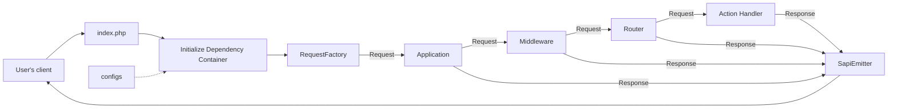

# Fluxo da aplicação

Depois de instalar o Yii, você tem uma aplicação Yii funcionando.  Esta
seção apresenta as funcionalidades que vêm com a aplicação, como o código
está organizado e como a aplicação trata as requisições de forma geral.

Diferente do próprio framework, depois que você instala um template de
projeto, ele é todo seu.  Você pode adicionar ou remover código e mudar o
que precisar.

## Funcionalidades

A aplicação instalada tem apenas uma página, acessível em
`http://localhost/`.  Ela usa um layout comum que você pode reaproveitar nas
próximas páginas.

<!--
You should also see a toolbar at the bottom of the browser window.
This is useful [debugger tool](https://github.com/yiisoft/yii-debug) provided by Yii to record and display a lot of
debugging information, such as log messages, response statuses, the database queries run, and so on.
-->

Além da aplicação web, você pode acessar um script de console via `./yii`
ou, no caso do Docker, `make yii`.  Use esse script para rodar tarefas em
segundo plano e de manutenção da aplicação, descritas na [seção de
aplicações de console](../tutorial/console-applications.md).

## Debugger experimental

O Yii tem um debugger que coleta dados de debug das requisições web e os
expõe pelo [Yii Dev Panel](https://yiisoft.github.io/yii-dev-panel/). O
debugger ainda está em desenvolvimento. Ele não foi lançado como pacote
estável, e a API, as rotas e a configuração podem mudar ou ser
descontinuadas.

Para testar a versão de desenvolvimento atual, instale o pacote da API de
debug:

```shell
composer require yiisoft/yii-debug-api:^3.0@dev
```

Ative o modo debug no `.env`:

```dotenv
APP_DEBUG=true
```

O pacote registra as rotas automaticamente. Inicie a aplicação e abra
`/debug` para conferir se a API de debug está disponível. Depois abra o [Yii
Dev Panel](https://yiisoft.github.io/yii-dev-panel/) e informe a URL da sua
aplicação.

> [!CAUTION]
> Use o modo debug no desenvolvimento local. Em produção, mantenha `APP_DEBUG=false` e não exponha as rotas de debug publicamente.

## Estrutura da aplicação

Os diretórios e arquivos mais importantes da sua aplicação são (considerando
que o diretório raiz da aplicação é `app`):

```
assets/                 Arquivos-fonte dos asset bundles.
config/                 Arquivos de configuração.
    common/             Configuração comum e definições de DI.
    console/            Configuração específica do console.
    environments/       Configuração por ambiente (dev/test/prod).
    web/                Configuração específica da web.
docker/                 Arquivos específicos do Docker.
public/                 Arquivos acessíveis publicamente pela internet.
    assets/             Assets publicados/compilados.
    index.php           Script de entrada.
runtime/                Arquivos gerados em tempo de execução.
src/                    Código-fonte da aplicação.
    Console/            Comandos de console.
    Shared/             Código compartilhado entre as aplicações web e console.
    Web/                Código específico da web (actions, handlers, layout).
        Shared/         Componentes web compartilhados.
            Layout/     Componentes e templates de layout.
    Environment.php     Classe de configuração do ambiente.
tests/                  Conjunto de testes Codeception da aplicação.
    Console/            Testes dos comandos de console.
    Functional/         Testes funcionais.
    Unit/               Testes unitários.
    Web/                Testes das actions web.
vendor/                 Pacotes do Composer instalados.
Makefile                Configuração do comando make.
yii                     Ponto de entrada da aplicação de console.
```

De forma geral, os arquivos da aplicação se dividem em dois grupos: os que
ficam em `app/public` e os que ficam nos outros diretórios. Os primeiros
podem ser acessados diretamente via HTTP (ou seja, no navegador), enquanto
os demais não devem ser expostos.

Toda aplicação tem um script de entrada `public/index.php`, o único script
PHP acessível pela web na aplicação.  O script de entrada usa um
[application runner](https://github.com/yiisoft/yii-runner) para criar uma
instância da requisição recebida com a ajuda de um dos pacotes PSR-7 e a
passa para uma instância da [aplicação](../structure/application.md). A
aplicação executa um conjunto de middlewares em sequência para processar a
requisição.  Depois, passa o resultado para o emitter, que envia a resposta
ao navegador.

Dependendo dos middlewares que você usa, a aplicação pode se comportar de
forma diferente. Por padrão, um router usa a URL requisitada e a
configuração para escolher um handler e executá-lo para produzir a resposta.

Você pode saber mais sobre o template de aplicação na [documentação do
pacote yiisoft/app](https://github.com/yiisoft/app/blob/master/README.md).

## Ciclo de vida da requisição

O diagrama a seguir mostra como uma aplicação trata uma requisição.



1. Um usuário faz uma requisição para o [script de
   entrada](../structure/entry-script.md) `public/index.php`.
2. O script de entrada, com a ajuda do application runner, carrega a
   [configuração](../concept/configuration.md) do container e cria uma
   instância da [aplicação](../structure/application.md) e os serviços
   necessários para tratar a requisição.
3. A request factory cria um objeto de requisição a partir da requisição
   bruta que veio do usuário.
4. A aplicação passa o objeto de requisição pelo array de middlewares
   configurado. Um deles normalmente é o router.
5. O router descobre qual handler executar com base na requisição e na
   configuração.
6. O handler pode carregar alguns dados, possivelmente de um banco de dados.
7. O handler monta uma resposta usando esses dados, diretamente ou com a
   ajuda do pacote de view.
8. O emitter recebe a resposta e cuida de enviá-la para o navegador do
   usuário.
