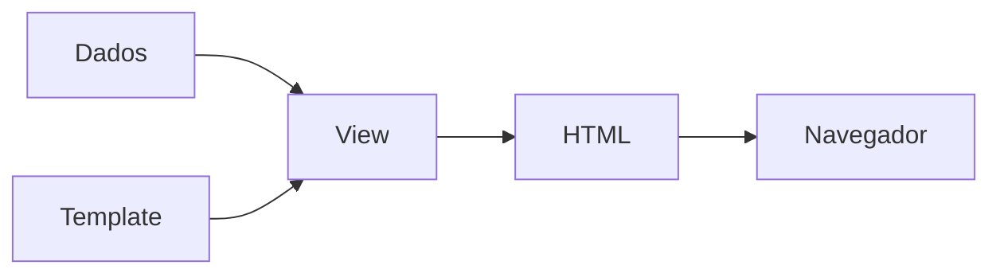

# Views

A view é responsável por apresentar os dados ao usuário final. Você entrega
a ela um template com alguns placeholders e lógica de apresentação, além de
alguns dados. A view passa os dados para o template e executa a lógica do
template. O resultado final está pronto para ser entregue ao usuário final,
seja um navegador, um arquivo para download, um e-mail a ser enviado ou
outra coisa.



No Yii3, as views normalmente são arquivos PHP com lógica de apresentação e
marcação HTML. O sistema de views oferece uma forma flexível de organizar a
camada de apresentação e suporta recursos como layouts e views parciais. Em
vez de templates PHP puros, você pode usar uma das template engines, como
[Twig](template-engines.md)  ou
[Blade](https://github.com/lee-to/yii-blade).

## Instalação

Para a funcionalidade básica de views, você precisa do pacote
`yiisoft/view`:

```sh
composer require yiisoft/view
```

Em aplicações web, instale também o pacote `yiisoft/yii-view-renderer`, que
oferece compatibilidade com [PSR-7](https://www.php-fig.org/psr/psr-7/) e
recursos específicos para a web:

```sh
composer require yiisoft/yii-view-renderer
```

Esses pacotes já vêm incluídos por padrão no template de aplicação
`yiisoft/app`.

## Conceitos básicos

Um arquivo de template de view contém lógica de apresentação.  No template
`yiisoft/app`, os arquivos de view normalmente ficam junto dos seus
controllers (por exemplo, `src/Web/Echo/Action.php`). Este é um exemplo
simples de arquivo de view, `src/Web/Echo/template.php`:

```php
<?php
use Yiisoft\Html\Html;
/* @var string $message */
?>

<p>The message is: <?= Html::encode($message) ?></p>
```

Aqui, `$message` é um dado da view passado quando você renderiza um template
com o `WebViewRenderer`. Por exemplo, `src/Web/Echo/Action.php`:

```php
<?php

declare(strict_types=1);

namespace App\Web\Echo;

use Psr\Http\Message\ResponseInterface;
use Yiisoft\Router\HydratorAttribute\RouteArgument;
use Yiisoft\Yii\View\Renderer\WebViewRenderer;

final readonly class Action
{
    public function __construct(
        private WebViewRenderer $viewRenderer,
    ) {}

    public function __invoke(
        #[RouteArgument('message')]
        string $message = 'Hello!'
    ): ResponseInterface
    {
        return $this->viewRenderer->render(__DIR__ . '/template', [
            'message' => $message,
        ]);
    }
}
```

O primeiro argumento do método `render()` é o caminho do arquivo de
template. No `yiisoft/app`, os arquivos de template normalmente ficam junto
das suas actions. O resultado já está pronto para ser enviado ao navegador,
então o devolvemos imediatamente.

## Trabalhando com layouts

A maioria das aplicações web usa um layout comum para todas as páginas. No
template `yiisoft/app`, os layouts ficam no diretório
`src/Web/Shared/Layout/Main/`. Você pode definir um layout padrão em
`config/common/params.php`:

```php
return [
    'yiisoft/yii-view-renderer' => [
        'viewPath' => null,
        'layout' => '@src/Web/Shared/Layout/Main/layout.php',
    ],
];
```

Um arquivo de layout típico, como `src/Web/Shared/Layout/Main/layout.php`,
tem esta cara:

```php
<?php

declare(strict_types=1);

use App\Web\Shared\Layout\Main\MainAsset;
use Yiisoft\Html\Html;

/**
 * @var \App\Shared\ApplicationParams $applicationParams
 * @var Yiisoft\Aliases\Aliases $aliases
 * @var Yiisoft\Assets\AssetManager $assetManager
 * @var string $content
 * @var string|null $csrf
 * @var Yiisoft\View\WebView $this
 * @var Yiisoft\Router\CurrentRoute $currentRoute
 * @var Yiisoft\Router\UrlGeneratorInterface $urlGenerator
 */

$assetManager->register(MainAsset::class);

$this->addCssFiles($assetManager->getCssFiles());
$this->addCssStrings($assetManager->getCssStrings());
$this->addJsFiles($assetManager->getJsFiles());
$this->addJsStrings($assetManager->getJsStrings());
$this->addJsVars($assetManager->getJsVars());

$this->beginPage()
?>
<!DOCTYPE html>
<html lang="<?= Html::encode($applicationParams->locale) ?>">
<head>
    <meta charset="<?= Html::encode($applicationParams->charset) ?>">
    <meta name="viewport" content="width=device-width, initial-scale=1">
    <link rel="icon" href="<?= $aliases->get('@baseUrl/favicon.svg') ?>" type="image/svg+xml">
    <title><?= Html::encode($this->getTitle()) ?></title>
    <?php $this->head() ?>
</head>
<body>
<?php $this->beginBody() ?>

<div class="header">
    <a href="/">
        <?= Html::encode($applicationParams->name) ?>
    </a>
</div>

<div class="content">    
    <?= $content ?>
</div>

<div class="footer">
    © <?= date('Y') ?>  <?= Html::encode($applicationParams->name) ?>    
</div>

<?php $this->endBody() ?>
</body>
</html>
<?php $this->endPage() ?>
```

No template acima, `$applicationParams` é um array de parâmetros de
`config/common/application.php`.

`$aliases` se refere ao [componente de aliases](../concept/aliases.md),
usado para obter a URL base da aplicação no servidor para montar URLs.

`$this` é uma instância da view que usamos para obter o título da página e
gerar a saída dos assets, tanto os padrão quanto os personalizados.

Com `$assetManager->register(MainAsset::class);` registramos um asset que define o `css` a ser incluído na página. Ele é
copiado automaticamente para `public/assets` no primeiro uso. Isso não ajuda muito com um único arquivo CSS, mas se torna útil
conforme o número de assets cresce.

> [!IMPORTANT]
> Nenhuma saída em templates PHP puros é codificada, então não se esqueça de usar `Html::encode()` para evitar
vulnerabilidades de segurança do tipo XSS.

Você encontra mais detalhes sobre o que está disponível no layout na
documentação do [yiisoft/view](https://github.com/yiisoft/view).

### Renderizando sem layout

Às vezes você precisa renderizar uma view sem layout (por exemplo, para
respostas AJAX):

```php
public function ajaxContent(): ResponseInterface
{
    return $this->viewRenderer
        ->withLayout(null)
        ->render('ajax-content', ['data' => $data]);
}

// Ou use o método renderPartial
public function ajaxContent(): ResponseInterface
{
    return $this->viewRenderer->renderPartial('ajax-content', ['data' => $data]);
}
```

## Views aninhadas e parciais

### Renderizando sub-views

Você pode renderizar outras views de dentro de uma view com o método `$this->render()`:

```php
<?php

declare(strict_types=1);

/**
 * @var \Yiisoft\View\WebView $this
 * @var \App\Entity\Post[] $posts
 */
?>
<div class="posts">
    <?php foreach ($posts as $post): ?>
        <?= $this->render('_post_item', ['post' => $post]) ?>
    <?php endforeach; ?>
</div>
```

**src/Web/Post/_item.php**
```php
<?php

declare(strict_types=1);

use Yiisoft\Html\Html;

/**
 * @var \Yiisoft\View\WebView $this
 * @var \App\Entity\Post $post
 */
?>
<article class="post">
    <h2><?= Html::encode($post->getTitle()) ?></h2>
    <p><?= Html::encode($post->getExcerpt()) ?></p>
    <time><?= $post->getCreatedAt()->format('Y-m-d') ?></time>
</article>
```

### Usando blocos

Os blocos permitem definir conteúdo em uma view e exibi-lo em outra,
normalmente nos layouts:

```php
// Em um arquivo de view
<?php $this->setBlock('sidebar', $this->render('_sidebar', ['items' => $sidebarItems])) ?>

// No arquivo de layout
<?php if ($this->hasBlock('sidebar')): ?>
    <aside><?= $this->getBlock('sidebar') ?></aside>
<?php endif ?>
```

## Renderizando como string

Se você precisa do conteúdo renderizado como string em vez de uma resposta
PSR-7:

```php
public function getEmailContent(): string
{
    return $this->viewRenderer->renderAsString('email/welcome', [
        'user' => $user,
    ]);
}
```

## Eventos de view

O sistema de views dispara eventos durante a renderização, e você pode
escutá-los:

```php
use Yiisoft\View\Event\WebView\BeforeRender;
use Yiisoft\View\Event\WebView\AfterRender;

// Exemplo de listener de eventos
final class ViewEventListener
{
    public function onBeforeRender(BeforeRender $event): void
    {
        // Adiciona uma classe CSS global com base no nome da view
        if (str_contains($event->getFile(), 'admin/')) {
            $event->getView()->registerCssClass('admin-view');
        }
    }

    public function onAfterRender(AfterRender $event): void
    {
        // Registra no log o tempo de renderização
        $this->logger->info('View rendered', [
            'view' => $event->getFile(),
            'time' => $event->getRenderTime(),
        ]);
    }
}
```
