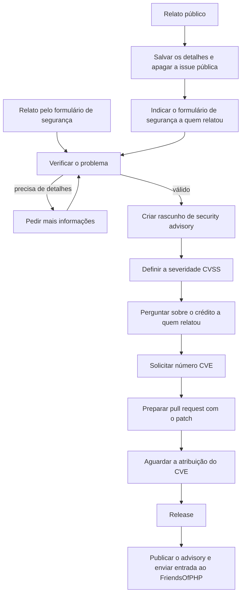

# 016 — Fluxo de segurança

Problemas de segurança normalmente são enviados pelo [formulário de
segurança](https://www.yiiframework.com/security).

Se um problema for relatado diretamente em uma página pública, como uma issue do repositório ou um tópico do fórum, copie a mensagem
e apague a issue. Agradeça a quem relatou e indique o formulário de segurança para a próxima vez.  

## Verificar

Verifique se o problema é válido. Peça mais informações, se necessário.

## Adicionar security advisory

Crie um rascunho de security advisory no GitHub.

### Descobrir a severidade

1. Obtenha a pontuação CVSS usando a [calculadora do
   NVD](https://nvd.nist.gov/vuln-metrics/cvss/v3-calculator).
2. Escolha a severidade com base na [escala de
   classificação](https://www.first.org/cvss/specification-document#Qualitative-Severity-Rating-Scale).

### Dar crédito a quem relatou

Pergunte a quem relatou se deseja receber crédito por ter encontrado o
problema. Se sim, indique a conta dessa pessoa no GitHub.

## Solicitar um número CVE

Quando estiver pronto, solicite um CVE.

## Preparar um patch

Prepare um pull request que corrija o problema. O GitHub permite fazer isso
em um fork privado.

## Aguardar a atribuição do número CVE 

Normalmente leva alguns dias.

## Release

- Faça o merge do pull request com o patch logo antes de criar a tag do
  próximo release do pacote.
- Publique o security advisory.
- Adicione o CVE em
  [FriendsOfPHP/security-advisories](https://github.com/FriendsOfPHP/security-advisories).
  Veja [#488](https://github.com/FriendsOfPHP/security-advisories/pull/488)
  como exemplo.
